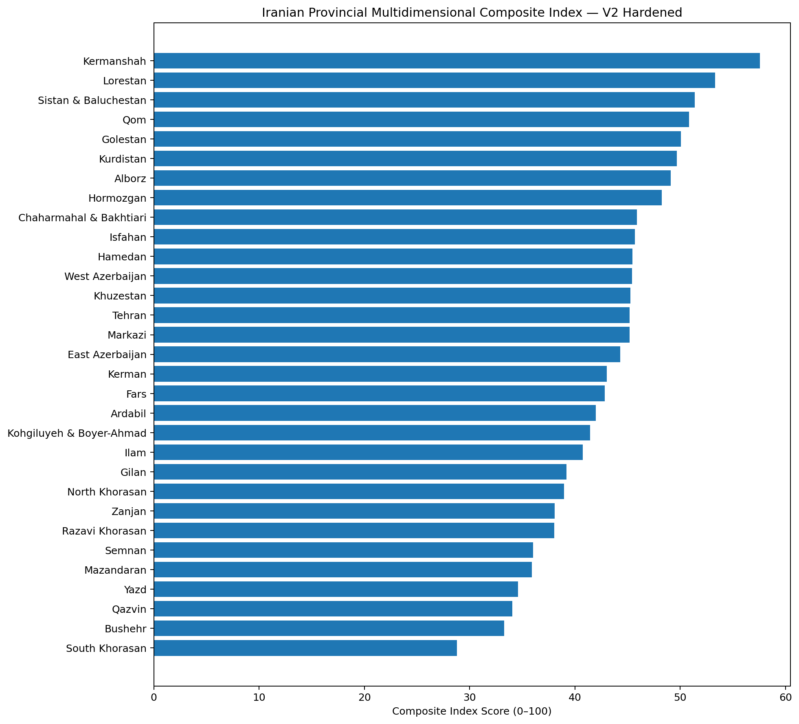
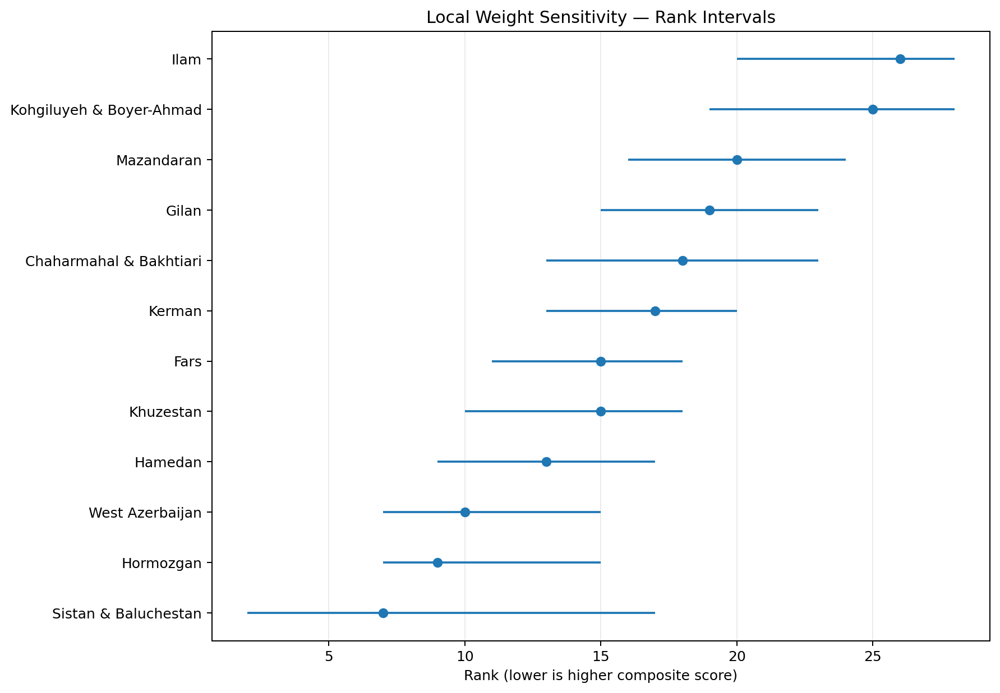

# Iran Provincial Multidimensional Composite Index — V2.1

An auditable, multi-year composite-index pipeline for comparative analysis across Iran's 31 provinces.

> **Public-release status:** PORTFOLIO PACKAGE — SOURCE DATA OMITTED PENDING RIGHTS REVIEW  
> **Model status:** READY WITH LIMITATIONS — PORTFOLIO USE

## Data rights and reproducibility notice

The indicators were collected independently from multiple sources, primarily understood to include the Statistical Center of Iran, then consolidated and processed for this project. Source-level attribution and redistribution terms have **not** been verified for every indicator. This repository therefore omits the original input workbook and row-level processed observation files pending that review. This is a precaution, not a claim that those data are restricted.

This is an independent analytical project; it is not an official publication of, nor endorsed by, the Statistical Center of Iran or any other data provider. The index is a comparative analytical model, not a causal estimate or an official judgement about provinces.

Before reproducing the pipeline, obtain the input workbook through sources whose applicable terms permit your intended use, and place it locally at `data/raw/قلبم ، ایرانم.xlsx` (or update `input_path` in both configuration files). Do not commit source files until redistribution terms have been checked. See `DATA_LICENSE_REVIEW.md` and `data/README.md`.


## Why this project

The project addresses a practical analytics problem: heterogeneous provincial indicators arrive with different units, directions, years, coverage levels and measurement concepts. The pipeline converts those observations into a transparent composite score while preserving the data lineage needed to explain how each provincial result was produced.

The model is designed as a **comparative analytical index**. It is not a causal estimate, a probability, or an absolute truth about a province.

## Research question

**How can heterogeneous provincial indicators be transformed into a transparent, reproducible and robustness-tested multidimensional composite index?**

## Current model snapshot

| Component | Final value |
|---|---:|
| Provinces | 31 |
| Registry series | 151 |
| Active series | 33 |
| Conditional active series | 33 |
| Excluded series | 118 |
| Categories | 5 |
| Subindicators | 22 |
| Reference anchor | 1403 |
| Baseline normalization | Within-year Min-Max |
| Automated integrity tests | 6/6 PASS |

### Analytical domains

- Economic — 35%
- Social — 30%
- Educational — 20%
- Security — 10%
- Infrastructure — 5%

These domain weights are explicit design assumptions; they are not presented as statistically estimated optimal weights.

## Methodology at a glance

```text
Raw Workbook
    ↓
Standardization
    ↓
Duplicate / Conflict Audit
    ↓
Canonical Indicator Registry
    ↓
Direction + Unit + Transform Rules
    ↓
Population Standardization (where meaningful)
    ↓
Within-Year Normalization
    ↓
Recency Weighting
    ↓
Temporal Series Aggregation
    ↓
Series → Subindicator → Category → Overall
    ↓
Robustness / Sensitivity
    ↓
External Convergent Check
    ↓
QA
```

## Multi-year design

The project intentionally retains historical observations instead of collapsing the model to one year. The 1403 reference year is a **recency anchor**, not a hard cutoff.

Baseline temporal weight:

`w(age) = max(0.25, 1 - 0.12 × age)`

Multiple years belonging to one logical series are aggregated into one province-series score after normalization and recency weighting.

## Population standardization

Population normalization is applied only to selected count/capacity concepts where it is substantively meaningful.

- School/class counts use same-year `Population6Plus` when available.
- Other selected count series use same-year total population when available, otherwise the nearest total-population observation within a maximum two-year gap.
- Rates, percentages, ratios, indexes and already-per-capita measures are **not** divided by population again.
- Denominator year and gap are retained in `data/processed/transformed_observations.csv`.

## Robustness

The repository contains:

- Alternative domain-weight scenarios
- Global Monte Carlo weight sensitivity
- Local Monte Carlo perturbations around baseline weights
- Indicator Leave-One-Out sensitivity
- Domain Leave-One-Out sensitivity
- Temporal sensitivity across reference years and decay functions
- Normalization sensitivity
- Redundancy / cross-category overlap audits

The current diagnostics show very high rank stability to temporal specifications (Spearman 0.994–1.000) and broader sensitivity to some changes in domain weights. Local Monte Carlo is materially tighter than unconstrained global weighting.

## External validation

A 2023 Subnational Human Development Index (SHDI) check from Global Data Lab matches 29 provinces because Tehran and Alborz are reported together in that external dataset.

Current association metrics:

- Pearson: -0.176
- Spearman: -0.157
- Kendall: -0.124

The association is weak and non-significant and the criterion overlaps conceptually with model dimensions, so it is treated as **convergent external evidence**, not clean independent validation.

## Data quality and provenance

The final model performs explicit checks for:

- duplicates and conflicting keys
- expected province-year completeness
- coverage
- missingness
- temporal freshness
- unit/rate/count interpretation
- provenance status
- redundancy

All 33 active series are currently `CONDITIONAL`. The supplied project workbook does not contain enough row-level source metadata to independently verify complete external provenance for every active series.

## Key outputs

### Final model

- `outputs/provincial_composite_index.csv`
- `outputs/series_scores.csv`
- `outputs/subindicator_scores.csv`
- `outputs/category_scores.csv`
- `outputs/province_category_contributions.csv`
- `outputs/province_score_decomposition.csv`

### Robustness and diagnostics

- `outputs/scenario_sensitivity.csv`
- `outputs/monte_carlo_global.csv`
- `outputs/monte_carlo_local.csv`
- `outputs/indicator_loo_final.csv`
- `outputs/domain_loo_final.csv`
- `outputs/temporal_sensitivity_final.csv`
- `outputs/normalization_sensitivity_final.csv`
- `outputs/redundancy_final.csv`
- `outputs/weight_audit.csv`
- `outputs/model_diagnostics_final.csv`

### Registry and lineage

- `registry/indicator_registry_final.csv`
- `registry/effective_weights.csv`
- `data/processed/raw_observations_standardized.csv`
- `data/processed/transformed_observations.csv`
- `data/processed/normalized_observations.csv`

## Repository structure

```text
Iran-Provincial-Composite-Index/
├── README.md
├── config/
├── data/
│   ├── raw/
│   └── processed/
├── docs/
├── notebooks/
├── outputs/
├── powerbi/
├── registry/
├── scripts/
├── src/
├── tests/
├── visuals/
├── requirements.txt
└── run_pipeline.py
```

## Reproduce the model

From the repository root:

```powershell
python -m pip install -r requirements.txt
python run_pipeline.py
python -m unittest discover -s tests -v
```

The included raw workbook is `data/raw/قلبم ، ایرانم.xlsx`. The pipeline reads it through the repo-local configuration and writes outputs to `outputs/`. Visuals/notebook dependencies are listed separately in `requirements-visuals.txt` and `requirements-notebook.txt`.

## Documentation

- [Architecture](docs/architecture.md)
- [Methodology](docs/methodology.md)
- [Data dictionary](docs/data_dictionary.md)
- [Active indicator registry](docs/active_indicator_registry.md)
- [Data quality](docs/data_quality.md)
- [Robustness](docs/robustness.md)
- [Validation](docs/validation.md)
- [Limitations](docs/limitations.md)
- [Decision log](docs/decision_log.md)
- [Change log](docs/change_log.md)
- [Power BI handoff](powerbi/README.md)

## Visuals

The `visuals/` directory contains presentation-ready figures derived from the frozen outputs. The Python visualization utility is available at `scripts/visualization_suite.py`.





## Important interpretation rule

A high or low score is the output of a specified model: indicator selection + transformations + normalization + temporal treatment + weighting. A series or domain's **contribution** is not a causal effect.

## License / data note

No public software license is asserted in this repository. The included provincial dataset is provided as project material for reproducibility; users should verify the original source terms before redistribution or commercial use.
